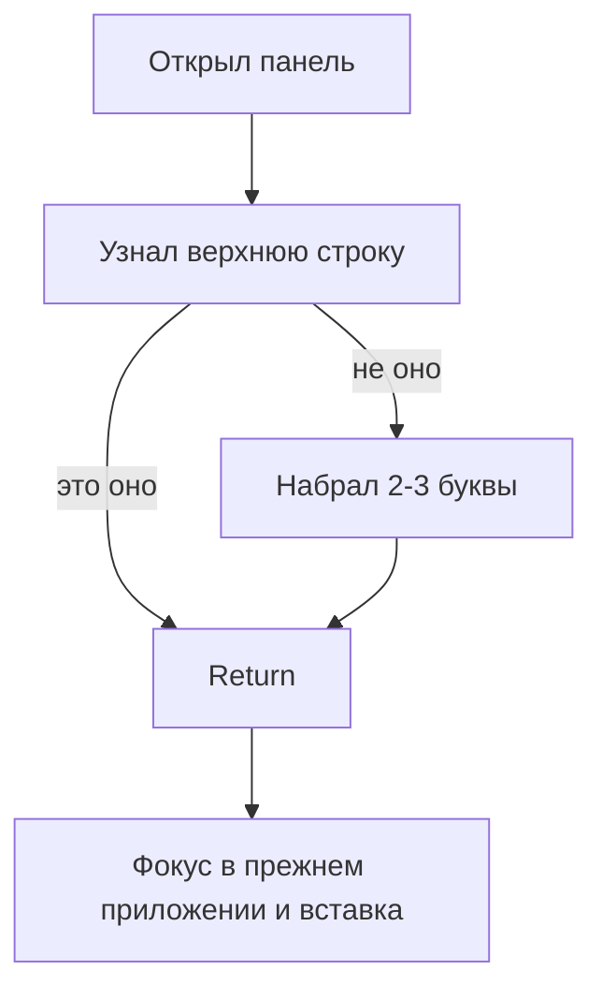

# Промпт: интерфейс VaultClip, максимально удобный человеку

Contact: [aleksey@karakuts.com](mailto:aleksey@karakuts.com)

Промпт для агента. **Код приложения не менять**, пока пользователь отдельно не попросит выполнить этот промпт. Этот документ — задание на следующий проход после [ui-human-usability-report.md](ui-human-usability-report.md) и редизайна U00–U37.

---

## 0. Миссия одним абзацем

Ты доводишь VaultClip (macOS 14+, меню-бар, локальная история буфера) до состояния, в котором человек **в середине чужой задачи** открывает панель, узнаёт нужную копию и вставляет её **не думая об интерфейсе**.

Удобство здесь — это:

1. **Меньше решений** — не выбирать между тремя способами сделать одно и то же.
2. **Меньше ожидания** — панель появляется и отвечает мгновенно; скролл не «думает».
3. **Безошибочный возврат** — после Return фокус снова в прежнем приложении, панель скрыта, вставка произошла туда, куда человек смотрел.
4. **Доверие** — пароль не мелькает, удаление обратимо, пустой экран говорит один следующий шаг.

Красота допустима **только** если она укорачивает путь `open → recognize → paste → back`. Если экран стал «богаче», а путь длиннее — это регресс.

Любой лишний клик, режим, подтверждение, охота глазами по шапке или «сейчас куда нажать?» между `open` и `back` — дефект, даже если визуально «аккуратнее».

---

## 1. Контекст продукта (не переизобретай)

| Факт | Следствие для UI |
|---|---|
| Форк Yippy: лаконичный UX «панель всегда рядом» | Не превращай панель в мини-IDE или дашборд |
| Без Dock-иконки, только меню-бар | Первый контакт — значок + ⌘⇧V; Welcome один раз |
| AES-GCM, Keychain, denylist менеджеров паролей | UI не трогает крипто/хранилище; секреты не светятся |
| Три вкладки: История / Избранное / Пароли | Три **режима**, не три фильтра одной ленты |
| Реестр команд `PanelCommandRegistry` | Единственная раскладка; таблица в `docs/ui-guidelines.md` синхронна тестам |
| Редизайн U00–U37 уже в ветке `ui-redesign-2026-11` | Не начинай «новый визуальный язык»; убирай трение поверх готового каркаса |
| Первый human-usability проход частично закрыт | См. раздел 3 «Уже закрыто» — не переделывай без регресса |

Источники правды:

- Клавиши и зоны: [docs/ui-guidelines.md](../ui-guidelines.md) + `PanelCommandRegistry` + `UIGuidelinesRegistryTests`
- Токены: `PanelTheme` (Spacing, Radius, TypeSizes, materials, motion)
- Отчёт редизайна: [docs/ui-redesign-2026-11-report.md](../ui-redesign-2026-11-report.md)
- Отчёт прошлого usability-прохода: [docs/prompts/ui-human-usability-report.md](ui-human-usability-report.md)

---

## 2. Как работать (процесс агента)

### 2.1 Порядок

1. **Сначала наблюдай.** Прогони `scripts/ui-preview.sh` (демо) и `EMPTY=1 scripts/ui-preview.sh` (пусто). Светлая / тёмная тема. Русский + хотя бы одна локаль не ru/en. Узкая боковая панель + «на весь экран».
2. **Список трения** до первой правки: сценарий человека → что видит / не может → файл / поверхность. Правь **только** пункты из этого списка и из раздела 4 «Остающееся трение».
3. **Одна правка = одна человеческая работа.** В отчёте пиши, *какой шаг человека исчез*, а не «стало аккуратнее».
4. **Не коммить / не пушь / не релизь**, пока пользователь явно не попросит.
5. В конце — короткий отчёт по-русски по шаблону раздела 12; обнови или дополни `docs/prompts/ui-human-usability-report.md`.

### 2.2 Жёсткие запреты на инфраструктуру

- Не трогай шифрование, denylist менеджеров паролей, Keychain, формат истории, каталог Application Support **боевой** установки.
- Превью и сиды только через XCTest bundle id и `--storage-root` / `VAULTCLIP_SEED_APP_SUPPORT`, как в `scripts/ui-preview.sh`.
- Не понижай покрытие и не отключай тесты реестра ради шортката.
- Не расширяй Linux-порт / другой тулкит в этой задаче.
- Контакт и copyright: Aleksey Karakuts `<aleksey@karakuts.com>`. Не добавляй `Co-authored-by: Cursor`.
- Комментарии — как в соседних файлах: одна строка у нового файла (что делает и где в архитектуре); без простыней.

### 2.3 Модель правок

| Делай | Не делай |
|---|---|
| Чини то, что человек чувствует руками/глазами/VoiceOver | Рефакторинг «на всякий случай» |
| Презентеры + L10n + узкий UI-слой | Параллельный UI «поудобнее» |
| Закрывай дыру: команда есть везде (клава / мышь / палитра / меню) | Вторую раскладку клавиш «для удобства» |
| Системные материалы, SF Symbols, системные шрифты | Свои контролы, градиенты, эмодзи, отдельную тему |

---

## 3. Уже закрыто предыдущим проходом (не ломай)

Сверь с [ui-human-usability-report.md](ui-human-usability-report.md). Считай закрытым, пока ручная проверка не покажет регресс:

- Подвал на узкой панели: обрезание **с конца**; ведущая подсказка «⏎ Вставить» сохраняется.
- Тост undo не перекрывает нижнюю строку списка и не перехватывает клики по списку (только кнопка «Отменить»).
- Welcome не открывает Help сам после Accessibility; тексты через outlets/каталог, не сравнение английских строк xib.
- Пустые состояния, подвал, настройки, шпаргалка, палитра, даты, относительное время — через `Localizable.xcstrings`, без `ru ? … : …`.
- Превью цвета: swatch + HEX/RGB/HSL + источник/время.
- Drag-out: пароли не отдают секрет; цвет уходит как HEX plain text.
- Копирование пароля: тост с секундами до автоочистки буфера (если включено).

Если находишь регресс в этих пунктах — чини в первую очередь.

---

## 4. Остающееся трение (приоритет)

Закрой то, что человек всё ещё чувствует. Порядок = частота боли × необратимость ошибки.

### P0 — ломает основной путь или доверие

1. **Единый владелец вёрстки шапки панели.** Сейчас `HistoryViewController+Layout` глушит storyboard-констрейнты и прячет лишние подписи. Человек видит прыжок layout, обрезанный поиск, мёртвый зазор. Колонка панели — один владелец. Storyboard-остаток, который больше не рисует UI, убери только когда сцена реально не нужна. Сцену настроек в storyboard не удаляй вслепую: сначала докажи, что программное окно — единственная точка входа.
2. **Edit-before-paste (⌘E) доведён до конца в панели.** Курсор сразу в тексте; ⌘Return вставляет правку; ⌘S кладёт в буфер без вставки в чужое окно; Esc не теряет введённое молча (стек U24 / EscapeResolver). Недоступно для пароля. Кнопка в превью = имя команды в реестре.
3. **VoiceOver end-to-end** по панели, настройкам, Welcome. У строки одна метка (тип + видимый текст + источник), без секрета. У SF Symbols действий — имя или tooltip; у декоративных рядом с текстом — `accessibilityElement = false`. Кастомные действия строки с человеческими глаголами. Палитра — отдельная группа. Каждое поле настроек — с подписью, не только placeholder.
4. **Вставка ↔ Accessibility.** Нет доступа → тот же текст, что `L10n.accessibilityPasteBlocked*`, + «Открыть настройки». История жива. Есть доступ → Return вставляет в предыдущее приложение и скрывает панель.

### P1 — частые сценарии с трением

5. **Превью «это то?»** для PDF, файла, длинного текста, изображения: метаданные достаточны, чтобы не вставлять наугад. Список не схлопывается в ноль при открытом превью (`PreviewPlacement`). Закрытие превью не сбрасывает выделение и не вставляет.
6. **Drag-out как жест**, не только модель: текст / картинка / файл утаскиваются в Finder, Mail, браузер ожидаемо. Пароль — никогда.
7. **Активный фильтр виден и сбрасываем без ⌥⌘.** Чип в подвале или в поле поиска («Текст · Safari»); «Сбросить фильтры» сбрасывает тип и приложение, не вкладку. На «Паролях» и при выключенном фильтре в настройках высота полосы = 0 без щели. На узкой панели: символ **или** подпись, не оба в каше.
8. **Пустые состояния с реальными действиями.** «Ничего не найдено» + попадания на другой вкладке → кнопка реально переключает вкладку и **оставляет запрос**. Пауза → «Возобновить» снимает паузу; иконка паузы различима в меню-баре в обеих темах.
9. **Мультивыделение.** Число выбранных и что Return вставит их в порядке списка с разделителем из настроек — видно до нажатия. Человек не гадает про порядок.

### P2 — редкий, но «ломает доверие при первом касании»

10. **Геометрия панели после смены монитора / notch / минимальной ширины.** Сохранённый фрейм не влезает → видимый край, не случайная точка и не нулевая ширина. Поиск, вкладки, список, подвал читаются на минимальной боковой ширине.
11. **Запись горячей клавиши.** Состояния: «нажмите», принято, конфликт, отмена. Список прочих команд на вкладке Клавиши — **только чтение**, те же символы, что в шпаргалке; не создавай иллюзию, что ⌘K переназначен.
12. **Denylist в Privacy.** Имя приложения + bundle id; удаление с той же строки; добавление выбором приложения, не только вставкой строки. Одна серая строка «зачем»: копии из этих приложений не пишутся.
13. **Контраст / Reduce Transparency / увеличенный текст панели.** Текст строки не серый-на-сером; ⌘=/⌘− не наезжает строками и не прячет подвал. `reduce motion`: появление панели/тоста/оверлея без длинного полёта; смена вкладки без анимации перехода — сохрани.
14. **Хит-зоны кнопок строки ≥ 24×24**, зазор между звездой и «Ещё», чтобы не путать. Номер ⌘N виден, пока кнопки скрыты; при наведении кнопки не прыгают высоту строки.

---

## 5. Персоны и работы (проектируй под частоту)

### 5.1 Персоны

| Персона | Как работает | Критерий успеха |
|---|---|---|
| **Dev** в Xcode/Terminal | Почти только клавиатура; ⌘⇧V → 2 буквы → Return или ⌘2 | < 2 с от открытия до вставки; глаза почти не нужны |
| **Designer** в Figma/браузере | Трекпад; узнаёт картинку/цвет в строке; иногда превью | Цвет/скриншот узнаётся без вставки |
| **Support / PM** в почте/Slack | Мышь + поиск; иногда multi-paste цитат | Мультивыделение понятно; Shift+Return чистит RTF |
| **Privacy-conscious** | Пароли, denylist, запись экрана, Touch ID | Секрет нигде не мелькает; отказ биометрии безопасен |
| **VoiceOver** | Только речь + жесты | Одна метка на строку; Esc-стек озвучивается; палитра навигируема |
| **Новичок (первый час)** | Welcome → Accessibility → первая вставка | Один экран объяснения; без принудительной справки |

### 5.2 Постоянные работы (по убыванию частоты)

1. Вставить то, что скопировал только что, или найти обрывок по 2–3 буквам и вставить.
2. Вставить как простой текст; вставить несколько строк подряд; вставить по ⌘1…⌘0 не глядя.
3. Узнать картинку / PDF / цвет / файл до вставки.
4. Закрепить важное (⌘D). Достать пароль, не показав мимоходом.
5. Отменить удаление (тост + ⌘Z). Понять пустой список и сделать один шаг.
6. Первый запуск: Accessibility → сразу вставить. Позже: сменить hotkey или паузу захвата без чтения Help.

**Редкие работы** (настройки, позиция панели, denylist, срок хранения) **не имеют права** занимать место на панели и на пути вставки.

### 5.3 Бюджет времени (ручной ориентир)

| Сценарий | Цель |
|---|---|
| Открыл → верхняя строка → Return | ≤ 1 с осознанного действия |
| Открыл → 2–3 буквы → стрелка → Return | ≤ 3 с |
| Открыл → узнал цвет/картинку в строке | без превью |
| Удалил → понял, что можно отменить | ≤ 1 с до чтения тоста |
| Первый запуск до первой успешной вставки | ≤ 2 экрана + системный диалог Accessibility |

---

## 6. Что уже решено и нельзя переигрывать

Источник правды по клавишам — `PanelCommandRegistry`. Таблица в `docs/ui-guidelines.md` обязана совпадать (`UIGuidelinesRegistryTests`).

### 6.1 Раскладка

- Открыть: ⌘⇧V. Вставить: Return. Как текст: Shift+Return. Быстрые: ⌘1…⌘9, ⌘0 = десятая.
- Копировать: ⌘C. Палитра: ⌘K. Поиск: ⌘F и type-to-search с фокусом списка (`PanelKeyRouter`).
- Превью: ⌘Y / Space. Quick Look: ⌥Space. Правка: ⌘E. Избранное: ⌘D. Удалить: ⌘⌫. Undo удаления: ⌘Z.
- Вкладки: ⌃] / ⌃[. Фильтры типа: ⌥⌘1…. Текст: ⌘= / ⌘−. Шпаргалка: ⌘/. Настройки: ⌘,. Закрыть: Esc / ⌘W.

### 6.2 Esc-стек (ровно один слой за раз)

`палитра → отказ/выход из правки → превью → фильтры → закрытие панели`

Не закрывай панель, пока сверху есть слой.

### 6.3 Инварианты приватности

Пароль **не** появляется в: заголовке строки, подзаголовке, метке VoiceOver, поиске, Recents меню, drag-out, multi-paste без явного `PasswordAccessGate`. Маска `••••••••` — интерфейс, не косметика.

### 6.4 Обратимость

- Удаление строки → тост «Отменить» (`PendingDeletionQueue`): клик + ⌘Z. Длительность удаления **не короче 8 с** (обычный тост ~4 с).
- Очистка всей истории — единственное место для явного диалога; текст говорит, что избранное и сохранённые пароли остаются.

### 6.5 Производительность

Презентация 5000 элементов + группировка дат — бюджет `docs/ui-guidelines.md` / `PerformanceBudgetTests` (порог ~200 мс в CI). Не грузи превью и иконки синхронно на путь скролла. Высота строки фиксирована на размер текста (`PanelTheme`).

### 6.6 Паритет входов

Каждая команда, которую может вызвать человек, доступна и с клавиатуры, и мышью: строка, контекстное меню, палитра, меню строки меню. Если действие есть только в одном месте — дыра.

Порядок групп в контекстном меню = палитра: **вставить → изменить → поделиться/открыть → опасное внизу**.

---

## 7. Закон панели (три зоны — три вопроса)

| Зона | Вопрос человека | Что обязательно |
|---|---|---|
| **Верх** | Куда я попал и как сузить список? | Вкладки-режимы, поиск всегда на виду, фильтры без щели когда выкл. |
| **Середина** | Какая это копия? | Скан L→R: иконка типа → текст → источник/время → ⌘N у первых 10 |
| **Низ** | Что сделает Return и сколько тут строк? | Счётчик слева, 1–3 правдивые подсказки справа |

### 7.1 Поиск

- Всегда на виду; набор с клавиатуры ищет; стрелки ходят по результатам.
- Плейсхолдер зависит от вкладки. На «Паролях»: комментарий, логин, URL — **не** секрет.
- Очистка: видимая кнопка clear при непустом тексте; Esc по стеку, если запрос — верхний слой.
- Длинный запрос в empty-state виден целиком или с осмысленным обрезанием с конца.

### 7.2 Вкладки

- Читаются как три режима, не как фильтр.
- Выбранный режим заметен зрячему и VoiceOver.
- ⌃]/⌃[ не сбрасывают поиск молча: empty-state с попаданиями на другой вкладке предлагает переход; кнопка **реально** переключает и оставляет запрос.

### 7.3 Фильтры

- Не спорят со списком за внимание.
- Выкл. / вкладка «Пароли» → высота 0, без щели.
- Активный фильтр виден («Текст · Safari») и сбрасывается без запоминания ⌥⌘.
- Узкая панель: символ **или** подпись.

### 7.4 Группы дат

- Человеческий язык: только что / сегодня / вчера / на этой неделе — как в группировке.
- Не дублируй полную дату и в группе, и в каждой строке.
- Внутри группы: последнее использование сверху.

### 7.5 Строка

- Длинный текст обрезается **с конца**. Tooltip = полный текст; у пароля tooltip нет.
- Избранное и замок не заменяют текст.
- Кнопки: hover + selected; не прыгают высоту; ⌘N виден, пока кнопки скрыты.
- Tooltip кнопки = глагол из меню/реестра. «Ещё» = те же команды, что ⌘K для строки.
- Удаление есть в меню строки и в палитре, не только в хоткее.
- Выделение с клавиатуры видно без мыши, в т.ч. unemphasized selection.

### 7.6 Подвал

- Слева: «Найдено 3 из 120», «4 выбрано», …
- Справа: 1–3 короткие подсказки **текущего** режима. В правке → ⌘Return / ⌘S / Esc.
- Если команда недоступна — её **нет** в подвале (не ври).

### 7.7 Правило клика мышью

Сейчас выбор и вставка разделены: одиночный клик **выбирает**, вставка — Return / кнопка / явный жест. Если меняешь — одно правило на всю панель + шпаргалка + подвал. Не оставляй «в половине мест клик вставляет».

---

## 8. Поверхности: критерии приёмки

Не изобретай параллельный UI. Правь эти места. Для каждой поверхности — DoD.

### 8.1 Панель-хост

Файлы: `HistoryViewController.swift`, `HistoryViewController+Layout.swift`, `HistoryViewController+Actions.swift`, `HistoryPanel.swift`.

- [ ] Один владелец колонки; нет прыжка layout при открытии.
- [ ] Размер/позиция применяются при каждом открытии; контент не ресайзит окно самовольно.
- [ ] На минимальной боковой ширине читаются поиск, вкладки, список, подвал.

### 8.2 Шапка / вкладки / фильтры

`HistoryTabBarView.swift`, `PanelFilterBarView.swift`, `PanelHeaderView.swift`.

- [ ] Нет мёртвого зазора от скрытых storyboard-лейблов.
- [ ] Фильтр-бар нулевой высоты когда не нужен.
- [ ] Кнопки шапки: a11y-имя или `accessibilityElement = false` если декоративные.

### 8.3 Список и строка

`HistoryRowView.swift`, `RowPresentation.swift`, `RowActionOverlay.swift`, `HistoryTableView.swift`.

- [ ] Фиксированная высота на размер текста; скан L→R стабилен.
- [ ] `refusesFirstResponder` на кнопках строки — не ломать (фокус не проваливается).
- [ ] Hover-overlay не крадёт ⌘N навсегда.
- [ ] Контекстное меню = палитра по группам.

### 8.4 Пусто / подвал / тост

`PanelEmptyStateModel.swift`, `PanelEmptyStateView.swift`, `PanelStatusBarModel.swift`, `PanelToastView.swift`.

- [ ] Загрузка: «Загрузка истории…» до `isHistoryLoaded`; не мигает «скопируйте что-нибудь».
- [ ] Пустая история + захват идёт → один шаг «скопируйте».
- [ ] Пауза → иконка + «Возобновить».
- [ ] Нет избранного → как закрепить (⌘D / звезда).
- [ ] Ничего не найдено → переход на вкладку / сброс фильтров — кнопки работают.
- [ ] Тост удаления: 8 с, ⌘Z, не перекрывает выделение, не перехватывает клавиши списка.

### 8.5 Превью и правка

`EmbeddedPreviewView.swift` (+ связанные модели preview/edit).

- [ ] Превью внутри панели, не вторым окном.
- [ ] Placement: узкая → низ, широкая → хвост; список не в ноль.
- [ ] Цвет/PDF/файл/длинный текст узнаваемы.
- [ ] ⌥Space: Quick Look только если есть файл; иначе внутреннее превью.
- [ ] ⌘E: полный цикл правки (см. P0).
- [ ] Закрытие превью ≠ вставка ≠ сброс selection.

### 8.6 Оверлеи

`CommandPaletteOverlayView.swift`, `CheatSheetOverlayView.swift`.

- [ ] Палитра: стрелки по командам, Return выполняет, Esc закрывает один слой.
- [ ] Шпаргалка ⌘/ — единственный «учитель» вместе с подвалом; без тура и бейджей «новое».
- [ ] Строки локализованы через каталог.

### 8.7 Меню-бар

`ClipStatusItem.swift`, `Controller.swift`.

- [ ] Клик = настройка (панель или меню). Правый клик (или запасной жест) всегда меню.
- [ ] Меню: показать/скрыть, пауза, очистить, настройки, выход.
- [ ] Recents: безопасные подписи как у строк; пароль не секретом; число = настройка.
- [ ] Иконка паузы различима light/dark.

### 8.8 Welcome / Help / About

`WelcomeViewController.swift`, Help, About.

- [ ] Welcome: зачем Accessibility (вставка по Return), одна кнопка, что если отказать, как включить позже.
- [ ] После разрешения — **не** открывать Help само.
- [ ] Help — по запросу; тексты не завязаны на сравнение английских строк xib.

### 8.9 Настройки

`SettingsTabViewController.swift`, `SettingsSwiftUITabs.swift`.

Шесть вкладок: Общие, Панель, Вставка, История, Конфиденциальность, Клавиши. Седьмую не добавляй.

- [ ] Заголовок окна = имя вкладки; высота следует форме; последняя вкладка помнится.
- [ ] Тумблер = глагол + серая строка, если следствие неочевидно.
- [ ] Опасное не вплотную к безобидному без пояснения про избранное/пароли.
- [ ] «Скрывать панель от записи экрана» (`sharingType`) работает пока панель открыта; по умолчанию выкл.; одна строка «зачем».
- [ ] Grace period Touch ID — человеческая фраза, не только степпер минут.
- [ ] Не дублируй частые команды панели в настройках и наоборот.

### 8.10 Локализация

`L10n.swift`, `Localizable.xcstrings`.

- [ ] Никаких `ru ? … : …` / самодельных развилок в презентерах и `SettingsUICopy.t`.
- [ ] Fallback каталога на английский для языка без перевода — ок; смесь языков в одной фразе — нет.
- [ ] Новые строки сразу в каталог.

---

## 9. Пароли и доверие (отдельный контракт)

- Вкладка «Пароли» отличается **содержанием**, не сюрпризом UI.
- Действия: копировать логин / копировать пароль / ещё. Копирование пароля = тот же затвор, что вставка.
- Отказ Touch ID → та же строка, без вставки, без показа секрета. Причина запроса одной фразой («Чтобы вставить пароль»).
- Пустая вкладка паролей объясняет **две** вещи отдельно:
  1. чужие менеджеры паролей в историю не пишутся;
  2. свой пароль сохраняется из элемента через палитру/меню.
- Не склеивай в абзац, который надо перечитывать.
- Никогда: секрет «на секунду» в анимации, Recents, заголовке окна, логе, tooltip.

---

## 10. Клавиатура / мышь / VoiceOver / движение — проход

### 10.1 Только клавиатура

Открыть → искать → ↑↓ → PgUp/PgDn → ⌘↑/⌘↓ → мультивыделение → вкладки → фильтр → превью → правка → палитра → шпаргалка → удаление → undo → закрытие.

Фокус не проваливается в кнопки строки и не застревает в оверлее.

### 10.2 Мышь / трекпад

Клик = выбор; вставка явным действием. Контекстное меню = палитра. Drag-out работает для не-паролей.

### 10.3 VoiceOver

Строка, избранное, поиск, вкладки, фильтры, подвал, тост, палитра, настройки, Welcome — объявляют смену состояния. Секрет не читается.

### 10.4 Accessibility display

Increase Contrast, Reduce Transparency, увеличенный текст панели, Reduce Motion — см. P2.

---

## 11. Чего не делать (антипаттерны)

- Тур, каретки, бейджи «новое», подсказки на каждый запуск.
- Диалог на удаление одной строки, на вставку, на смену вкладки, на очистку поиска.
- Отдельная тема, кастомные контролы вместо `NSSegmentedControl` / SwiftUI `Form` / системного поиска.
- Градиенты, эмодзи в UI, glow, «AI-dashboard» компоновка.
- Показ секрета «на секунду».
- Вторая раскладка клавиш.
- Расширение Linux-порта в этой задаче.
- Коммит/push/релиз без явной просьбы.
- Правка production Application Support.
- «Улучшение» уже закрытых пунктов раздела 3 без доказанного регресса.

---

## 12. Проверка (задача не сделана без этого)

### 12.1 Ручной проход на `scripts/ui-preview.sh` (демо + EMPTY)

1. TextEdit: скопировал текст → ⌘⇧V → Return → текст вставлен, фокус в TextEdit, панель скрыта.
2. Две буквы → стрелкой не первый результат → Return.
3. Shift+Return: RTF/HTML как plain text.
4. ⌘2 вставляет вторую видимую строку даже с фокусом в поиске.
5. Три строки выбраны → Return → порядок списка + разделитель из настроек.
6. ⌘E → правка → Esc не глотает текст молча; ⌘Return вставляет правку; ⌘S копирует правку.
7. ⌘⌫ → тост → ⌘Z вернул строку.
8. Пароль: маска; VO без секрета; поиск по секрету пуст; drag-out без секрета.
9. Пустая история; пауза; «ничего не найдено» с другой вкладкой; отказ Accessibility.
10. Боковая min-ширина: поиск/вкладки/список/подвал; фильтр без дыры.
11. Light / Dark / Increase Contrast / Reduce Transparency / текст панели больше стандарта.
12. Локаль ≠ ru/en: empty, подвал, настройки, тост — один язык фразы.
13. VoiceOver: строка, звезда, палитра, поиск.
14. Смена монитора / fullscreen position / край у notch — панель видима и usable.

В отчёте: какой пункт не смог выполнить и почему (например, нет Screen Recording для Computer Use).

### 12.2 Автоматика

- `./scripts/run-unit-tests.sh` зелёный.
- Презентеры empty/status покрыты на строки каталога.
- `UIGuidelinesRegistryTests` зелёный, если трогали команды.
- UI-тесты на CI не обязательны (меню-бар на headless зависает) — ручной проход обязателен.
- Не трогай coverage floor; при новых презентерах — тесты на поведение, не на зашитый русский.

### 12.3 Отчёт в конце

Коротко, по-русски, в `docs/prompts/ui-human-usability-report.md` (дописать секцию нового прохода или заменить с датой):

1. Какие человеческие шаги исчезли.
2. Какие файлы.
3. Что проверено из §12.1–12.2.
4. Что сознательно не менялось (уже не мешало / вне scope).
5. Без пересказа diff.

---

## 13. Карта файлов (быстрый индекс)

| Область | Пути |
|---|---|
| Панель | `VaultClip/Sources/Windows/History/HistoryViewController*.swift`, `HistoryPanel.swift` |
| Шапка/фильтры | `HistoryTabBarView.swift`, `PanelFilterBarView.swift`, `PanelHeaderView.swift` |
| Строка | `CellViews/HistoryRowView.swift`, `Models/Panel/RowPresentation.swift`, `RowActionOverlay.swift` |
| Empty/status/toast | `PanelEmptyState*.swift`, `PanelStatusBarModel.swift`, `PanelToastView.swift` |
| Preview/edit | `EmbeddedPreviewView.swift` |
| Оверлеи | `CommandPaletteOverlayView.swift`, `CheatSheetOverlayView.swift` |
| Меню-бар | `Windows/Status Item/ClipStatusItem.swift`, `Models/Controller.swift` |
| Welcome | `Windows/Welcome/WelcomeViewController.swift` |
| Settings | `SettingsTabViewController.swift`, `SettingsSwiftUITabs.swift` |
| L10n | `Localization/L10n.swift`, `Resources/Localizable.xcstrings` |
| Клавиши/фокус | `PanelCommandRegistry`, `PanelKeyRouter`, `EscapeResolver` |
| Тема | `PanelTheme` |
| Скрипты | `scripts/ui-preview.sh`, `scripts/run-unit-tests.sh` |

---

## 14. Definition of Done (чеклист агента перед сдачей)

- [ ] Список трения составлен **до** правок и сверен с §4.
- [ ] Каждая правка объяснима одной исчезнувшей человеческой работой.
- [ ] P0 закрыты или явно заблокированы внешней причиной (с записью в отчёт).
- [ ] Инварианты §6 (клавиши, Esc, пароли, perf) не нарушены.
- [ ] §12.1 пройден или каждый пропуск объяснён.
- [ ] Юнит-тесты зелёные; реестр синхронен гайдлайну.
- [ ] Отчёт обновлён; коммита нет, пока не попросили.
- [ ] Между `open` и `back` не добавлено ни одного обязательного лишнего шага.
